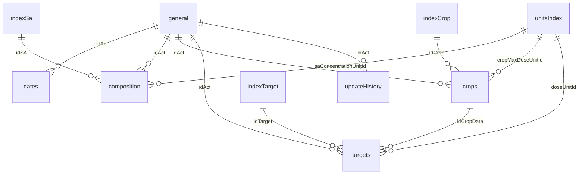

# PhytowebCorder — Documentation technique

> Généré le 2026-07-24 par exploration du dépôt local `c:\Users\llaridant\Documents\PhytowebCorder`.

## Table des matières

1. [Vue d'ensemble](#1-vue-densemble)
2. [Structure du projet](#2-structure-du-projet)
3. [Source de données : Phytoweb](#3-source-de-données--phytoweb)
4. [Pipeline ETL](#4-pipeline-etl)
5. [Détail des fichiers](#5-détail-des-fichiers)
6. [Schéma de la base de données](#6-schéma-de-la-base-de-données)
7. [Dépendances](#7-dépendances)
8. [Comment exécuter le projet](#8-comment-exécuter-le-projet)
9. [Points d'attention / dette technique](#9-points-dattention--dette-technique)

---

## 1. Vue d'ensemble

**PhytowebCorder** est un pipeline ETL (Extract-Transform-Load) en Python qui :

1. Se connecte en **SFTP** au serveur open data du SPF Santé publique belge (**Phytoweb**),
2. Télécharge des fichiers **JSON** décrivant les autorisations de mise sur le marché de **produits phytopharmaceutiques** (pesticides, engrais, produits de protection des plantes) en Belgique,
3. Parse et normalise ces données (substances actives, cultures traitées, ennemis/cibles visés, doses, dates d'autorisation, etc.),
4. Charge le résultat dans une **base de données relationnelle** (MySQL en production, SQLite pour un usage local/historique), afin de permettre des requêtes structurées sur l'ensemble du catalogue phytosanitaire belge.

Le projet ne contient pas d'interface web ni d'API : c'est un **outil batch en ligne de commande**, pensé pour être exécuté périodiquement (chargement initial complet + mises à jour incrémentales).

---

## 2. Structure du projet

```
PhytowebCorder/
├── PhytowebServer.py           # Client SFTP (connexion Phytoweb, listing et téléchargement JSON)
├── generate_first_db.py        # Script de CHARGEMENT INITIAL complet (batché, avec caches)
├── update_DB.py                # Script de MISE À JOUR incrémentale (fichiers "DELTA")
├── export_to_mysql.py          # Conversion phytowebCorder.db (SQLite) → dump .sql MySQL
├── database/
│   └── init_first_db.py        # Connexion MySQL + définition du schéma (CREATE TABLE)
├── phytowebCorder.db           # Base SQLite locale (instantané / historique de développement)
├── phytowebCorder_mysql.sql    # Dump SQL généré (sortie de export_to_mysql.py)
├── temp.py                     # Script de test ad hoc (génération d'un UUID)
├── test.py                     # Script de test ad hoc (boucle max())
├── .vscode/
│   └── settings.json           # Configuration d'éditeur (couleurs de dossier)
└── __pycache__/                # Bytecode Python compilé (généré automatiquement)
```

Le dépôt **n'est pas versionné avec Git** actuellement (aucun `.git`, pas d'historique de commits).

---

## 3. Source de données : Phytoweb

- **Protocole** : SFTP (SSH File Transfer Protocol), via la librairie [`paramiko`](https://www.paramiko.org/)
- **Hôte** : `ftp.health.belgium.be`
- **Port** : `22`
- **Identifiants** : `ftppanama-opendata` / `guest` (compte public en lecture seule — données open data)
- **Format des fichiers** : JSON, un fichier par lot de produits
- **Deux catégories de fichiers** distinguées par leur nom :
  - Fichiers **complets** (nom sans `"DELTA"`) : utilisés pour le chargement initial de toute la base.
  - Fichiers **`DELTA`** : contiennent uniquement les changements récents, utilisés pour les mises à jour incrémentales.

Chaque entrée JSON représente un **acte d'autorisation** (« PPP » = Produit Phytopharmaceutique) avec sa structure imbriquée :
- Informations générales (numéro d'autorisation, dates, statut, sujet de l'acte)
- `pestProduct` : nom du produit, formulation, type(s) de produit, groupe d'utilisateurs
- `composition.PRODUCT_Components` : liste des substances actives (SA) et leur concentration
- `pestUse.pestCrops` : liste des cultures autorisées, avec pour chacune :
  - `pestCropEnemies` : liste des ennemis/cibles (ravageurs, maladies...) et les doses d'application min/max
  - `pestCropRiskMitigs` : mesures de mitigation des risques (zones tampons, etc.)
- `pestLabelling.pestLabels` : étiquettes réglementaires (ex. label `SPe8`, relatif à la protection des abeilles/pollinisateurs)

---

## 4. Pipeline ETL

```mermaid
flowchart TD
    A[Serveur SFTP Phytoweb<br/>ftp.health.belgium.be] -->|paramiko| B(PhytowebServer.py)
    B --> C{Type de fichier}
    C -->|Fichiers complets<br/>sans "DELTA"| D[generate_first_db.py<br/>Chargement initial]
    C -->|Fichiers "DELTA"| E[update_DB.py<br/>Mise à jour incrémentale]
    D --> F[(MySQL<br/>database/init_first_db.py)]
    E --> F
    F --> G[export_to_mysql.py]
    H[(phytowebCorder.db<br/>SQLite local)] --> G
    G --> I[phytowebCorder_mysql.sql<br/>dump pour phpMyAdmin]
```

**Étapes détaillées** (communes à `generate_first_db.py` et `update_DB.py`) :

1. Connexion SFTP et listing récursif de tous les fichiers accessibles (`list_all_sftp_paths`).
2. Filtrage des fichiers `.json`, séparés en « complets » vs « DELTA ».
3. Téléchargement + parsing JSON (`get_json_from_sftp`).
4. Pour chaque acte (PPP) :
   - Extraction des champs généraux → table `general`
   - Extraction des dates réglementaires → table `dates`
   - Boucle sur les substances actives → table `composition` (+ index `indexSa`)
   - Boucle sur les cultures → table `crops` (+ index `indexCrop`)
   - Boucle sur les cibles/ennemis par culture → table `targets` (+ index `indexTarget`)
   - Normalisation des unités de dose → table `unitsIndex`
5. Insertion en base (MySQL), avec calcul de drapeaux dérivés :
   - `mostRecentAct` : l'acte est-il le plus récent pour ce numéro d'autorisation ?
   - `CentVingtFlag` : le numéro d'autorisation contient `/120` (produits à usage particulier)
   - `spe8Flag` : présence d'une étiquette `SPe8` (protection des pollinisateurs)
   - `microOrgaFlag` : la substance active est un micro-organisme
   - `semenceTreatmentFlag` / `granulTreatmentFlag` : traitement de semences / granulés

---

## 5. Détail des fichiers

### [PhytowebServer.py](PhytowebServer.py)
Module utilitaire réseau, sans dépendance au reste du projet.
- `list_all_sftp_paths(host, port, username, password)` : parcourt récursivement le répertoire SFTP distant et retourne la liste de tous les chemins (fichiers + dossiers).
- `get_json_from_sftp(host, port, username, password, remote_path)` : télécharge un fichier distant et le parse en `dict` Python via `json.loads`.

### [database/init_first_db.py](database/init_first_db.py)
Point d'entrée de connexion à la base **MySQL** de production, importé par `generate_first_db.py` et `update_DB.py`.
- Ouvre une connexion `mysql.connector` vers un hébergement distant (host `91.234.194.249`, base `c2544857c_corderPhytoweb`).
- Exécute les `CREATE TABLE IF NOT EXISTS` pour les 9 tables du schéma (voir [section 6](#6-schéma-de-la-base-de-données)).
- ⚠️ Contient les **identifiants MySQL en clair** dans le code source (voir [section 9](#9-points-dattention--dette-technique)).
- Une ligne commentée montre qu'une connexion SQLite locale (`phytowebCorder.db`) était utilisée auparavant, avant la bascule vers MySQL.

### [generate_first_db.py](generate_first_db.py)
Script de **chargement initial complet**. Traite tous les fichiers JSON *sans* `"DELTA"` dans leur nom.
- Version optimisée pour le volume : caches en mémoire (`_sa_cache`, `_crop_cache`, `_target_cache`, `_unit_cache`, `_mostrecent_cache`) préchargés une fois (`_preload_caches`) pour éviter un `SELECT` par ligne.
- Insertions par lots (`executemany`, `BATCH_SIZE = 500`) avec flush automatique (`_maybe_flush`) et flush final après chaque fichier JSON.
- Gère la reconnexion MySQL (`get_cursor` avec `conn.ping(reconnect=True)`).
- Fonctions utilitaires : `SAID`, `CROPID`, `TARGETID`, `UNITID` (génèrent/retrouvent un identifiant `uuid4` préfixé par domaine, ex. `sa_...`, `pwc_...`, `target_...`, `unit_...`), `MostRecentAct`, `format_date_mysql` (normalise plusieurs formats de date vers `YYYY-MM-DD`).

### [update_DB.py](update_DB.py)
Script de **mise à jour incrémentale**. Traite uniquement les fichiers contenant `"DELTA"`.
- Logique quasi identique à `generate_first_db.py`, mais **sans caches ni batching** : chaque insertion est faite ligne par ligne avec `cursor.execute` + `conn.commit()` immédiat, et une vérification préalable via `newEntryCheck` (évite les doublons sur `numAut` + `actDate` + `subject`).
- Alimente en plus la table `updateHistory` pour tracer chaque nouvel acte inséré lors d'une mise à jour.
- Beaucoup de code dupliqué avec `generate_first_db.py` (mêmes fonctions `__ExctractData__`, `Csv2Excel`, `format_date_mysql`, etc.).

### [export_to_mysql.py](export_to_mysql.py)
Utilitaire de migration : lit le schéma et les données de `phytowebCorder.db` (SQLite) et génère `phytowebCorder_mysql.sql`, un dump SQL compatible MySQL/phpMyAdmin.
- Convertit les types SQLite → MySQL (`TEXT`→`TEXT`, `REAL`→`DOUBLE`, `INTEGER`→`INT`, `BOOLEAN`→`TINYINT(1)`, `DATE`→`VARCHAR(20)`).
- Remplace les clés primaires `TEXT PRIMARY KEY` par `VARCHAR(36) PRIMARY KEY` (limitation MySQL).
- Échappe les valeurs et écrit des instructions `INSERT INTO` table par table.

### [phytowebCorder.db](phytowebCorder.db)
Base **SQLite locale**, probablement un instantané de développement/historique. Son schéma actuel (inspecté directement) est **légèrement en retard** par rapport au schéma MySQL défini dans `database/init_first_db.py` (colonnes de normalisation d'unités manquantes — voir [section 9](#9-points-dattention--dette-technique)).

### [phytowebCorder_mysql.sql](phytowebCorder_mysql.sql)
Dump SQL généré par `export_to_mysql.py`, destiné à être importé via phpMyAdmin sur l'hébergement MySQL.

### [temp.py](temp.py) et [test.py](test.py)
Scripts de test ad hoc sans rapport direct avec le pipeline (génération d'un UUID, boucle `max()`). Semblent être des brouillons laissés dans le dépôt, pas de suite de tests automatisés formelle.

### [.vscode/settings.json](.vscode/settings.json)
Configuration mineure de l'extension VSCode « Folder Color » — sans impact fonctionnel.

---

## 6. Schéma de la base de données

Le schéma « cible » ci-dessous est celui défini dans `database/init_first_db.py` (MySQL, production). La base SQLite locale (`phytowebCorder.db`) suit un schéma antérieur légèrement plus simple (indiqué en note).

### Vue relationnelle



### `general` — un enregistrement par acte d'autorisation
| Colonne | Type | Description |
|---|---|---|
| `idAct` | VARCHAR(255) PK | Identifiant unique de l'acte (`act_<uuid4>`) |
| `actDate` | DATE | Date d'envoi de l'acte |
| `mostRecentAct` | BOOLEAN | Est-ce l'acte le plus récent pour ce numéro d'autorisation ? |
| `numAut` | TEXT | Numéro d'autorisation du produit |
| `productName` | TEXT | Nom commercial du produit |
| `productComposition` | TEXT | Résumé texte des substances actives et concentrations |
| `productType` | TEXT | Type(s) de produit (insecticide, fongicide, etc.) |
| `statut` | TEXT | Code de décision d'autorisation |
| `subject` | TEXT | Objet de l'acte (nouvelle autorisation, retrait, modification…) |
| `user` | TEXT | Groupe d'utilisateurs autorisés (professionnel/amateur) |
| `productFormulation` | TEXT | Code du type de formulation |
| `productFormulationPhrase` | TEXT | Libellé du type de formulation |
| `productAttribut` | TEXT | Attributs additionnels concaténés |
| `CentVingtFlag` | BOOLEAN | Numéro d'autorisation contenant `/120` |
| `referenceFlag` | BOOLEAN | Produit basé sur une autre autorisation de référence |
| `spe8Flag` | BOOLEAN | Présence de l'étiquette réglementaire `SPe8` (pollinisateurs) |
| `microOrgaFlag` | BOOLEAN | La composition contient un micro-organisme |

### `composition` — substances actives par acte
| Colonne | Type | Description |
|---|---|---|
| `idComposition` | VARCHAR(255) PK | `compo_<uuid4>` |
| `idAct` | TEXT | FK → `general.idAct` |
| `idSA` | TEXT | FK → `indexSa.idSA` |
| `saName` | TEXT | Nom de la substance active |
| `saConcentration` | REAL | Concentration (valeur pure) |
| `saConcentrationUnit` | TEXT | Unité de concentration (libellé) |
| `saConcentrationUnitId` | TEXT | FK → `unitsIndex.idUnit` |
| `saConcentrationNormalised` | REAL | Concentration normalisée *(réservé — actuellement toujours 0)* |
| `dmaSa` | REAL | *(réservé — actuellement toujours 0)* |

### `dates` — dates réglementaires par acte
| Colonne | Type | Description |
|---|---|---|
| `idDate` | VARCHAR(255) PK | `dateData_<uuid4>` |
| `idAct` | TEXT | FK → `general.idAct` |
| `firstAuthorizationDate` | DATE | Date de première autorisation du produit |
| `authorizationStartDate` | DATE | Début de validité de l'acte |
| `authorizationEndDate` | DATE | Fin de validité de l'acte |
| `saleToleranceDate` | DATE | Date limite de vente tolérée |
| `useToleranceDate` | DATE | Date limite d'utilisation tolérée |
| `distributionToleranceDate` | DATE | Date limite de distribution tolérée |

### `crops` — cultures traitées par acte
| Colonne | Type | Description |
|---|---|---|
| `idCropData` | VARCHAR(255) PK | `cropData_<uuid4>` |
| `idCrop` | TEXT | FK → `indexCrop.idCrop` |
| `idAct` | TEXT | FK → `general.idAct` |
| `cropName` | TEXT | Nom de la culture |
| `treatmentLocalisation` | TEXT | Lieu d'application (plein champ, serre…) |
| `treatmentType` | TEXT | Type de traitement |
| `bufferZone` | TEXT | Description de la zone tampon (texte FR) |
| `mitigationRisk` | TEXT | Code de mesure de mitigation des risques |
| `cropApplicationStade` | TEXT | Stade de croissance au moment de l'application |
| `semenceTreatmentFlag` | BOOLEAN | Traitement de semences |
| `granulTreatmentFlag` | BOOLEAN | Application sous forme de granulés |
| `cropMaxDose` | REAL | Dose maximale (calculée = max des cibles associées) |
| `cropMaxDoseUnit` | TEXT | Unité de la dose maximale |
| `cropMaxDoseUnitId` | TEXT | FK → `unitsIndex.idUnit` |
| `cropMaxApp` | INTEGER | Nombre maximal d'applications |
| `dmaCrop` | REAL | *(réservé — actuellement toujours 0)* |
| `arCrop` | REAL | *(réservé — actuellement toujours 0)* |

### `targets` — cibles (ennemis/ravageurs) par culture
| Colonne | Type | Description |
|---|---|---|
| `idTargetData` | VARCHAR(255) PK | `target_<uuid4>` |
| `idCropData` | TEXT | FK → `crops.idCropData` |
| `idCrop` | TEXT | FK → `indexCrop.idCrop` |
| `idAct` | TEXT | FK → `general.idAct` |
| `target` | TEXT | Nom de la cible (ravageur, maladie…) |
| `idTarget` | TEXT | FK → `indexTarget.idTarget` |
| `minDose` | REAL | Dose d'application minimale |
| `maxDose` | REAL | Dose d'application maximale |
| `doseUnit` | TEXT | Unité de dose |
| `doseUnitId` | TEXT | FK → `unitsIndex.idUnit` |
| `maxApp` | INTEGER | Nombre maximal d'applications |
| `doseReference` | REAL | *(réservé — actuellement toujours 0)* |
| `arTarget` | REAL | *(réservé — actuellement toujours 0)* |

### Tables d'index (déduplication)
| Table | Colonnes | Rôle |
|---|---|---|
| `indexSa` | `idSA` PK, `saName` UNIQUE | Référentiel des substances actives |
| `indexCrop` | `idCrop` PK, `cropName` UNIQUE | Référentiel des cultures |
| `indexTarget` | `idTarget` PK, `targetName` UNIQUE | Référentiel des cibles/ravageurs |
| `unitsIndex` | `idUnit` PK, `unitName` UNIQUE, `normalisationFactor` | Référentiel des unités de dose, avec facteur de normalisation *(non encore utilisé)* |

### `updateHistory` — journal des mises à jour incrémentales
| Colonne | Type | Description |
|---|---|---|
| `idUpdate` | VARCHAR(255) PK | `update_<uuid4>` |
| `updateDate` | DATE | Date d'exécution de la mise à jour |
| `idAct` | TEXT | FK → `general.idAct` inséré |
| `dateAct` | DATE | Date de l'acte inséré |
| `productName` | TEXT | Nom du produit concerné |
| `subject` | TEXT | Objet de l'acte |

> **Note** : la base SQLite locale `phytowebCorder.db` ne possède **pas** la table `unitsIndex`, ni les colonnes `saConcentrationNormalised`/`dmaSa` (composition), `cropMaxDoseUnitId`/`dmaCrop`/`arCrop` (crops), `doseUnitId`/`doseReference`/`arTarget` (targets). Elle contient actuellement 3012 actes (`general`), 87 600 lignes `crops`/`targets`, 4013 lignes `composition`, et 19 entrées dans `updateHistory`.

---

## 7. Dépendances

Aucun fichier `requirements.txt` n'est présent dans le dépôt. D'après les imports relevés dans le code, les dépendances externes sont :

| Package | Utilisé pour |
|---|---|
| `paramiko` | Client SFTP/SSH ([PhytowebServer.py](PhytowebServer.py)) |
| `mysql-connector-python` | Connexion à la base MySQL de production |
| `tqdm` | Barres de progression lors du traitement des PPP |
| `pandas` | Conversion CSV → Excel (`Csv2Excel`, actuellement non appelée dans le flux principal) |
| `openpyxl` | Écriture de fichiers Excel |
| `sqlite3` | Module standard, utilisé par `export_to_mysql.py` |

---

## 8. Comment exécuter le projet

```powershell
# Chargement initial complet (à n'exécuter qu'une seule fois, base vide)
python generate_first_db.py

# Mises à jour incrémentales (à exécuter périodiquement)
python update_DB.py

# Génération d'un dump SQL à partir de la base SQLite locale
python export_to_mysql.py
```

Les deux scripts de chargement (`generate_first_db.py`, `update_DB.py`) importent automatiquement `database/init_first_db.py`, qui **ouvre la connexion MySQL et crée les tables si nécessaire** dès l'import du module.

---

## 9. Points d'attention / dette technique

- **🔴 Identifiants en clair dans le code source** : `database/init_first_db.py` contient l'hôte, l'utilisateur et le **mot de passe MySQL** en clair. Ces mêmes identifiants sont donc présents dans `phytowebCorder_mysql.sql`... non, mais le code source est à traiter comme sensible. Recommandation : déplacer vers des variables d'environnement (`os.environ`) ou un fichier `.env` exclu du contrôle de version.
- **Absence de dépôt Git** : aucun historique de versions n'est actuellement suivi pour ce projet — tout changement (y compris accidentel) n'est pas récupérable.
- **Absence de `requirements.txt`/`pyproject.toml`** : les dépendances doivent être déduites manuellement des imports.
- **Duplication de code importante** entre [generate_first_db.py](generate_first_db.py) et [update_DB.py](update_DB.py) (fonctions `__ExctractData__`, `format_date_mysql`, `Csv2Excel`, `SAID`/`CROPID`/`TARGETID`/`UNITID`...). Un module commun (ex. `phytoweb_common.py`) permettrait d'éviter les divergences (le comportement de `MostRecentAct` diffère déjà légèrement entre les deux scripts).
- **Désynchronisation de schéma** entre la base SQLite locale (`phytowebCorder.db`) et le schéma MySQL actuel (voir note en fin de [section 6](#6-schéma-de-la-base-de-données)) — `export_to_mysql.py` produirait donc un dump incomplet par rapport au schéma de production actuel.
- **Booléens stockés comme chaînes** (`"True"`/`"False"`) plutôt que comme vrais booléens Python dans plusieurs endroits du code de transformation, alors que les colonnes cibles sont typées `BOOLEAN`.
- **Colonnes « réservées » jamais alimentées** : `saConcentrationNormalised`, `dmaSa`, `dmaCrop`, `arCrop`, `doseReference`, `arTarget` sont systématiquement insérées à `0` — la logique de normalisation par unité (`unitsIndex.normalisationFactor`) semble prévue mais non implémentée.
- **Pas de tests automatisés** : `temp.py` et `test.py` sont des scripts de vérification manuelle, pas une suite de tests (pas de `pytest`, pas de dossier `tests/`).
- **Gestion d'erreurs réseau limitée** dans [PhytowebServer.py](PhytowebServer.py) : `set_missing_host_key_policy(paramiko.AutoAddPolicy())` accepte automatiquement toute clé hôte SSH inconnue (risque de type MITM si le réseau n'est pas de confiance), et il n'y a pas de mécanisme de retry en cas de coupure réseau lors d'un téléchargement volumineux.
